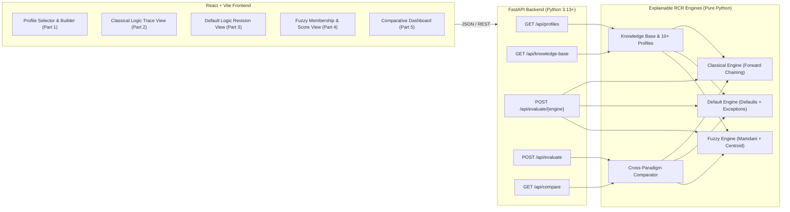

# University Orientation System — RCR (TP Final 2026/2027)


> **Université de Guelma · Département d'Informatique**  
> **Module:** *Représentation des Connaissances et Raisonnement (RCR)* — 4th Year AI Engineering (*4ᵉ année Ingéniorat IA*)  
> **Official Specification:** [TP final 2026 RCR.pdf](./TP%20final%202026%20RCR.pdf)

A full-stack, explainable **university specialty orientation system** built with **FastAPI (Python)** and **React (Vite)** that models student profiles and compares three Knowledge Representation & Reasoning (KRR / RCR) paradigms side by side:

1. **Classical Logic** (*Logique classique*) — crisp facts, propositional/predicate rules, and deterministic forward-chaining deduction.
2. **Default Reasoning** (*Raisonnement par défaut*) — Reiter-style non-monotonic rules that draw provisional conclusions under incomplete information and revise them when exceptions arise.
3. **Fuzzy Logic** (*Logique floue*) — linguistic variables, membership functions, Mamdani fuzzy rules, and defuzzified suitability degrees.

---

## Table of Contents

- [1. Project Overview & Domain](#1-project-overview--domain)
- [2. How We Will Build It (Architecture & Tech Stack)](#2-how-we-will-build-it-architecture--tech-stack)
- [3. Planned Repository Structure](#3-planned-repository-structure)
- [4. Shared Data Model & API Contract](#4-shared-data-model--api-contract)
- [5. Open Team Tasks (5 Parts)](#5-open-team-tasks-5-parts)
  - [Part 1 — Knowledge Modeling, Profiles & Project Foundation](#part-1--knowledge-modeling-profiles--project-foundation)
  - [Part 2 — Classical Logic Engine & UI](#part-2--classical-logic-engine--ui)
  - [Part 3 — Default Reasoning Engine, Exceptions & UI](#part-3--default-reasoning-engine-exceptions--ui)
  - [Part 4 — Fuzzy Logic Engine & UI](#part-4--fuzzy-logic-engine--ui)
  - [Part 5 — Comparative Analysis, Dashboard & Final Report](#part-5--comparative-analysis-dashboard--final-report)
- [6. Git Workflow & How New Members Join](#6-git-workflow--how-new-members-join)
- [7. Planned Local Development Commands](#7-planned-local-development-commands)
- [8. Deliverables & Defense Validation Checklist](#8-deliverables--defense-validation-checklist)

---

## 1. Project Overview & Domain

University orientation consists of recommending academic specialties adapted to a student's profile based on academic performance, technical skills, personal interests, and admission prerequisites.

### Target Specialties (3 Specialties)
| Code | Specialty (EN) | Spécialité (FR) | Key Orientation Criteria |
| :--- | :--- | :--- | :--- |
| `AI` | **Artificial Intelligence** | *Intelligence Artificielle* | Math/Probability, Algorithms, Python/ML skills, AI interest |
| `SE` | **Software Engineering** | *Génie Logiciel* | Programming, Software Design/OOP, Databases, SE interest |
| `CYBER` | **Cybersecurity** | *Cybersécurité* | Networks, Operating Systems, Security/Scripting skills, Cyber interest |

### Core Pedagogical Objectives
- Build at least **10 diverse student profiles** (strong all-rounder, specialist profiles, borderline scores, missing-information cases, and explicit exception cases).
- Implement **explainable & verifiable** reasoning engines in Python: every output must show *which facts, rules, exceptions, or calculations* produced the conclusion (required for the *séance de validation TP*).
- Compare all three paradigms across four axes: **representation & mechanisms**, **exceptions & missing data**, **imprecision handling**, and **strengths & limitations**.

---

## 2. How We Will Build It (Architecture & Tech Stack)

We adopt a clean, decoupled **FastAPI + React** architecture so each team member can develop and test their reasoning engine independently while contributing a dedicated interactive panel to the web application.



### Tech Stack Rationale
| Layer | Technology | Why We Chose It |
| :--- | :--- | :--- |
| **Reasoning Core** | **Python 3.13+** (pure Python + NumPy) | Fully transparent rule execution, zero black-box magic, easy to justify line-by-line during TP validation. |
| **Backend API** | **FastAPI + Pydantic v2 + Uvicorn** | Automatic OpenAPI/Swagger docs (`/docs`), strict schema validation across team modules, fast async endpoints. |
| **Automated Tests** | **Pytest** | Reproducible verification of all 10+ profiles, exception revisions, and fuzzy score calculations. |
| **Frontend UI** | **React + Vite + TypeScript + Tailwind CSS** | Fast interactive workbench to test predefined/custom student profiles and visualize proof trees, revisions, and fuzzy curves. |
| **Visualizations** | **Recharts** (or **Chart.js**) | Clean membership function curves, rule activation charts, and side-by-side comparison visuals exportable for the 6-page report. |

---

## 3. Planned Repository Structure

```text
university-orientation-rcr/
├── README.md                          # Master blueprint, architecture & 5-part open task board
├── .gitignore                         # Python, Node/React, LaTeX & IDE ignore rules
├── TP final 2026 RCR.pdf              # Official project specification
│
├── backend/                           # FastAPI + Explainable RCR Engines
│   ├── app/
│   │   ├── main.py                    # FastAPI app initialization, CORS & routers
│   │   ├── models/
│   │   │   └── schemas.py             # Shared Pydantic models (profiles, rules, traces, results)
│   │   ├── data/
│   │   │   ├── specialties.json       # 3 specialties & admission thresholds
│   │   │   ├── profiles.json          # >= 10 diverse student profiles
│   │   │   └── rules_catalog.json     # Shared base facts & human-readable rule definitions
│   │   ├── engines/
│   │   │   ├── classical_engine.py    # Part 2: Propositional/predicate forward chaining
│   │   │   ├── default_engine.py      # Part 3: Reiter default rules + exception revision
│   │   │   ├── fuzzy_engine.py        # Part 4: Fuzzification, >= 6 Mamdani rules, centroid defuzz
│   │   │   └── comparator.py          # Part 5: Unified runner & comparative metrics
│   │   └── routers/
│   │       ├── profiles.py            # GET /api/profiles, GET /api/knowledge-base
│   │       └── evaluate.py            # POST /api/evaluate/*, GET /api/compare
│   ├── scripts/
│   │   └── export_results.py          # CLI script to generate verifiable JSON/CSV/MD tables
│   ├── tests/
│   │   ├── test_profiles.py
│   │   ├── test_classical.py
│   │   ├── test_default.py
│   │   ├── test_fuzzy.py
│   │   └── test_comparator.py
│   └── requirements.txt
│
├── frontend/                          # React + Vite Interactive Web UI
│   ├── src/
│   │   ├── api/
│   │   │   └── client.ts              # Typed REST client calling FastAPI
│   │   ├── types/
│   │   │   └── orientation.ts         # TypeScript interfaces matching Pydantic schemas
│   │   ├── components/
│   │   │   ├── profiles/              # Part 1: Student profile selector & live editor
│   │   │   ├── classical/             # Part 2: Accessible/recommended badges + deduction trace
│   │   │   ├── default-logic/         # Part 3: Provisional vs. revised conclusions + exception diff
│   │   │   ├── fuzzy/                 # Part 4: Membership plots, rule weights & suitability gauge
│   │   │   └── comparison/            # Part 5: 3-approach comparison table & analytics charts
│   │   └── App.tsx
│   └── package.json
│
└── report/                            # Final report (<= 6 pages) & exported figures/tables
```

---

## 4. Shared Data Model & API Contract

To let all 5 parts progress in parallel without merge conflicts, every backend engine and frontend panel adheres to this shared contract.

### REST Endpoints
| Method | Endpoint | Owner | Purpose |
| :--- | :--- | :--- | :--- |
| `GET` | `/api/profiles` | Part 1 | Returns the ≥ 10 predefined test student profiles. |
| `GET` | `/api/knowledge-base` | Part 1 | Exposes specialties, criteria, classical rules, default rules, and fuzzy sets/rules. |
| `POST` | `/api/evaluate/classical` | Part 2 | Evaluates a student profile with classical logic + full proof trace. |
| `POST` | `/api/evaluate/default` | Part 3 | Evaluates a profile with default logic (provisional conclusions, exceptions, revisions). |
| `POST` | `/api/evaluate/fuzzy` | Part 4 | Evaluates a profile with fuzzy logic (membership degrees, rule activations, crisp suitability score). |
| `POST` | `/api/evaluate` | Part 5 | Runs all 3 engines together for a single profile and returns unified + comparative output. |
| `GET` | `/api/compare` | Part 5 | Batch-evaluates all ≥ 10 profiles across all 3 engines for comparative analysis & export. |

### Shared `StudentProfile` Input Schema (Example)
```json
{
  "id": "S01",
  "name": "Student 01 — Strong Math & Algorithms",
  "grades": {
    "gpa": 15.2,
    "algorithms": 16.5,
    "programming": 15.0,
    "mathematics": 17.0,
    "networks": 11.5,
    "databases": 13.0
  },
  "skills": ["python", "machine_learning", "problem_solving"],
  "interests": {
    "AI": 18.0,
    "SE": 12.0,
    "CYBER": 8.0
  },
  "flags": {
    "has_disciplinary_sanction": false,
    "has_failed_prerequisites": false,
    "attendance_warning": false,
    "missing_fields": []
  }
}
```
> **Note:** Numeric grades/interest scales use `/20` (standard Algerian university scale) so both crisp thresholds (Classical/Default) and linguistic fuzzy sets (*Weak / Medium / Strong*) remain intuitive and directly verifiable. Nullable fields allow explicitly testing missing-information handling in Default Reasoning.

---

## 5. Open Team Tasks (5 Parts)

> **Team Lead Note:** All 5 parts below are currently **OPEN**. As teammates join the repository, replace `TBD` with each member's GitHub handle and move the status to `🟡 In Progress` or `✅ Done`.

### Assignment Board

> Track all open tasks live in the [**GitHub Issues Tab**](https://github.com/3boudi/university-orientation-rcr/issues) or by [**Milestones**](https://github.com/3boudi/university-orientation-rcr/milestones).

| Part | PDF Stage | Core Scope | GitHub Issues | Recommended Branch | Status | Assigned To |
| :---: | :--- | :--- | :--- | :--- | :---: | :--- |
| **Part 1** | *Étape 1* | Knowledge Modeling, ≥10 Profiles & Core App Foundation | [#1](https://github.com/3boudi/university-orientation-rcr/issues/1), [#2](https://github.com/3boudi/university-orientation-rcr/issues/2), [#3](https://github.com/3boudi/university-orientation-rcr/issues/3), [#4](https://github.com/3boudi/university-orientation-rcr/issues/4) ([M1](https://github.com/3boudi/university-orientation-rcr/milestone/1)) | `feat/part-1-modeling-foundation` | 🟢 Open | `TBD` |
| **Part 2** | *Étape 2* | Classical Logic Engine, Proof Traces & Classical UI | [#5](https://github.com/3boudi/university-orientation-rcr/issues/5), [#6](https://github.com/3boudi/university-orientation-rcr/issues/6) ([M2](https://github.com/3boudi/university-orientation-rcr/milestone/2)) | `feat/part-2-classical-logic` | 🟢 Open | `TBD` |
| **Part 3** | *Étape 3* | Default Reasoning Engine, Exceptions, Revisions & UI | [#7](https://github.com/3boudi/university-orientation-rcr/issues/7), [#8](https://github.com/3boudi/university-orientation-rcr/issues/8) ([M3](https://github.com/3boudi/university-orientation-rcr/milestone/3)) | `feat/part-3-default-reasoning` | 🟢 Open | `TBD` |
| **Part 4** | *Étape 4* | Fuzzy Logic Engine, Membership Plots & Fuzzy UI | [#9](https://github.com/3boudi/university-orientation-rcr/issues/9), [#10](https://github.com/3boudi/university-orientation-rcr/issues/10) ([M4](https://github.com/3boudi/university-orientation-rcr/milestone/4)) | `feat/part-4-fuzzy-logic` | 🟢 Open | `TBD` |
| **Part 5** | *Étape 5* | Comparative Analysis, Unified Dashboard & 6-Page Report | [#11](https://github.com/3boudi/university-orientation-rcr/issues/11), [#12](https://github.com/3boudi/university-orientation-rcr/issues/12), [#13](https://github.com/3boudi/university-orientation-rcr/issues/13) ([M5](https://github.com/3boudi/university-orientation-rcr/milestone/5)) | `feat/part-5-comparison-report` | 🟢 Open | `TBD` |

---

### Part 1 — Knowledge Modeling, Profiles & Project Foundation
- **Assigned To:** `TBD` | **Status:** `🟢 Open` | **Branch:** `feat/part-1-modeling-foundation` | **Covers:** *PDF Étape 1* | **Issues:** [#1](https://github.com/3boudi/university-orientation-rcr/issues/1), [#2](https://github.com/3boudi/university-orientation-rcr/issues/2), [#3](https://github.com/3boudi/university-orientation-rcr/issues/3), [#4](https://github.com/3boudi/university-orientation-rcr/issues/4)

**Goal:** Establish the shared domain knowledge, ≥ 10 diverse student profiles, Pydantic data contracts, FastAPI skeleton, and React profile selector/builder so Parts 2–5 plug in cleanly.

**Backend Tasks (Python / FastAPI)**
- [ ] **([#1](https://github.com/3boudi/university-orientation-rcr/issues/1))** Choose and formalize the 3 university specialties (`AI` / *Intelligence Artificielle*, `SE` / *Génie Logiciel*, `CYBER` / *Cybersécurité*) in `backend/app/data/specialties.json`.
- [ ] **([#1](https://github.com/3boudi/university-orientation-rcr/issues/1))** Identify and formalize all orientation criteria: academic results, skills, interests, and admission conditions (`backend/app/data/specialties.json`).
- [ ] **([#2](https://github.com/3boudi/university-orientation-rcr/issues/2))** Design at least **10 distinct student profiles** (`backend/app/data/profiles.json`) intentionally covering: clear matches, multi-specialty matches, borderline grades (for fuzzy logic), incomplete/missing data (for default rules), and explicit exception triggers (e.g., failed core prerequisite or disciplinary/attendance constraint).
- [ ] **([#1](https://github.com/3boudi/university-orientation-rcr/issues/1))** Define and document the shared base facts & rule specifications that serve all 3 approaches (`backend/app/data/rules_catalog.json`).
- [ ] **([#3](https://github.com/3boudi/university-orientation-rcr/issues/3))** Scaffold FastAPI (`backend/app/main.py`, CORS config, `requirements.txt`), define shared Pydantic schemas (`backend/app/models/schemas.py`), and implement `GET /api/profiles` and `GET /api/knowledge-base`.
- [ ] **([#2](https://github.com/3boudi/university-orientation-rcr/issues/2))** Write `backend/tests/test_profiles.py` validating schema integrity and profile coverage.

**Frontend Tasks (React + Vite)**
- [ ] **([#4](https://github.com/3boudi/university-orientation-rcr/issues/4))** Scaffold React + Vite + TypeScript + Tailwind CSS under `frontend/` and create the typed API client (`frontend/src/api/client.ts`).
- [ ] **([#4](https://github.com/3boudi/university-orientation-rcr/issues/4))** Build the **Profile Selector & Custom Profile Builder** (`frontend/src/components/profiles/`) allowing users to pick any of the 10+ presets or modify grades/interests/flags live.
- [ ] **([#4](https://github.com/3boudi/university-orientation-rcr/issues/4))** Create the top-level layout with tabbed or multi-panel placeholders ready for Parts 2, 3, 4, and 5.

**Report & Validation Deliverables**
- [ ] Draft **Section 1 (Knowledge Modeling)** of the report: specialty table, criteria definitions, and summary table of the 10+ student profiles.

**Definition of Done**
- `uvicorn app.main:app --reload` runs cleanly with `/docs` showing `/api/profiles` and `/api/knowledge-base`.
- All ≥ 10 profiles pass schema validation (`pytest tests/test_profiles.py`).
- React app renders the profile list and lets users inspect or customize a student profile.

---

### Part 2 — Classical Logic Engine & UI
- **Assigned To:** `TBD` | **Status:** `🟢 Open` | **Branch:** `feat/part-2-classical-logic` | **Covers:** *PDF Étape 2* | **Issues:** [#5](https://github.com/3boudi/university-orientation-rcr/issues/5), [#6](https://github.com/3boudi/university-orientation-rcr/issues/6)

**Goal:** Represent orientation knowledge in propositional and/or first-order predicate logic, implement a deterministic deduction engine separating *accessible* vs. *recommended* specialties, and visualize full proof justifications.

**Backend Tasks (Python / FastAPI)**
- [ ] Formalize crisp facts (e.g., `StrongAlgo(s)`, `GoodMath(s)`, `HighInterest(s, AI)`, `PrerequisitesMet(s, sp)`) and inference rules in propositional/predicate form.
- [ ] Define clear rule layers distinguishing **Accessible specialties** (*spécialités accessibles*) from **Recommended specialties** (*spécialités recommandées*).
- [ ] Implement a forward-chaining deduction engine in `backend/app/engines/classical_engine.py` that returns:
  - Derived facts
  - Accessible specialties & recommended specialties
  - Step-by-step **justification trace** (which rule ID fired, which premises matched, and which conclusion was deduced)
- [ ] Expose `POST /api/evaluate/classical` in `backend/app/routers/evaluate.py`.
- [ ] Write `backend/tests/test_classical.py` testing all 10+ profiles and verifying deterministic rule traces.

**Frontend Tasks (React + Vite)**
- [ ] Build the **Classical Logic View** (`frontend/src/components/classical/`) displaying:
  - Status badges per specialty (*Recommended*, *Accessible*, *Not Accessible*)
  - Interactive **Deduction / Proof Trace** showing extracted facts and every fired rule (`Premises => Conclusion`).

**Report & Validation Deliverables**
- [ ] Draft **Section 2 (Classical Logic)** of the report: formal logical notation of facts & rules, inference algorithm description, and justified results across the 10+ profiles.

**Definition of Done**
- Every deduction on all 10+ profiles is reproducible and justified by explicit rule IDs and facts.
- `pytest tests/test_classical.py` passes 100%.
- UI clearly shows accessible vs. recommended specialties and the proof trace.

---

### Part 3 — Default Reasoning Engine, Exceptions & UI
- **Assigned To:** `TBD` | **Status:** `🟢 Open` | **Branch:** `feat/part-3-default-reasoning` | **Covers:** *PDF Étape 3* | **Issues:** [#7](https://github.com/3boudi/university-orientation-rcr/issues/7), [#8](https://github.com/3boudi/university-orientation-rcr/issues/8)

**Goal:** Implement non-monotonic default reasoning (Reiter-style defaults `α : β / γ`) with at least 4 default rules and at least 1 real exception mechanism that visibly revises provisional conclusions, then compare outputs with Classical Logic.

**Backend Tasks (Python / FastAPI)**
- [ ] Define **at least 4 default rules** (`prerequisite α : justification β / conclusion γ`) to draw provisional conclusions when contrary information is absent, for example:
  - *D1:* Strong algorithms & programming + no contrary evidence → provisionally assume readiness for `AI` / `SE`.
  - *D2:* Missing specialty interest score + strong related grades + no contrary evidence → provisionally assume moderate/positive interest.
  - *D3:* General GPA ≥ threshold + no disciplinary/attendance alert → provisionally assume student is eligible for advanced tracks.
  - *D4:* Strong networks/OS + no security-prerequisite failure → provisionally recommend `CYBER`.
- [ ] Implement **at least 1 explicit exception** (recommended: 2–3 clear exceptions, e.g., *failed mandatory math prerequisite blocks provisional AI recommendation*, or *explicit low interest / missing required project retracts provisional track*) that **effectively revises** a provisional conclusion.
- [ ] Build `backend/app/engines/default_engine.py` tracking:
  - **Initial provisional conclusions** (applied defaults)
  - **Detected exceptions / contrary facts**
  - **Revised final conclusions** (what was retracted and why)
  - **Diff vs. Classical Logic** (cases where default logic concludes when classical logic stays silent, and cases where exceptions trigger revision)
- [ ] Expose `POST /api/evaluate/default` in `backend/app/routers/evaluate.py`.
- [ ] Write `backend/tests/test_default.py` demonstrating both unblocked defaults (missing info) and active belief revision on multiple student profiles.

**Frontend Tasks (React + Vite)**
- [ ] Build the **Default Reasoning View** (`frontend/src/components/default-logic/`) highlighting:
  - Applied default rules (`α : β / γ`)
  - **Provisional → Exception Triggered → Revised Conclusion** visual timeline / diff card
  - Side-by-side highlight of differences compared to Classical Logic.

**Report & Validation Deliverables**
- [ ] Draft **Section 3 (Default Reasoning)** of the report: formal default rule definitions, exception revision walk-through on multiple profiles, and comparison with Classical Logic.

**Definition of Done**
- ≥ 4 default rules and ≥ 1 working belief-revision exception verified on multiple profiles.
- `pytest tests/test_default.py` passes 100%, including explicit revision assertions.
- UI visually distinguishes provisional conclusions, triggered exceptions, and revised final outcomes.

---

### Part 4 — Fuzzy Logic Engine & UI
- **Assigned To:** `TBD` | **Status:** `🟢 Open` | **Branch:** `feat/part-4-fuzzy-logic` | **Covers:** *PDF Étape 4* | **Issues:** [#9](https://github.com/3boudi/university-orientation-rcr/issues/9), [#10](https://github.com/3boudi/university-orientation-rcr/issues/10)

**Goal:** Model graded academic skills and imprecise interests using fuzzy sets, membership functions, ≥ 6 Mamdani fuzzy rules, and defuzzification to compute a continuous suitability score (*degré d'adéquation*) for each specialty.

**Backend Tasks (Python / FastAPI)**
- [ ] Define **at least 3 input variables** (e.g., *Algorithms Level*, *Programming Level*, *Specialty Interest* — optionally plus *Domain Core Grade* per specialty) on `[0, 20]` and **1 output variable**: *Suitability Degree* (*Degré d'adéquation*) on `[0, 100]`.
- [ ] Define triangular and/or trapezoidal **membership functions** for linguistic terms (*Low / Faible*, *Medium / Moyen*, *High / Élevé*) in `backend/app/engines/fuzzy_engine.py`.
- [ ] Build **at least 6 Mamdani fuzzy rules** (recommended: 9–12 well-balanced rules covering low, medium, and high suitability combinations) with transparent `min` (AND) / `max` (OR) aggregation and **centroid defuzzification**.
- [ ] Return rich explainability data per specialty:
  - Crisp inputs & computed membership degrees `μ(x)` for every term
  - Firing strength of every activated fuzzy rule
  - Aggregated output curve points (ready for frontend plotting!)
  - Final defuzzified suitability score (`0–100%`) and linguistic interpretation (*Weak / Moderate / Strong / Excellent Fit*).
- [ ] Expose `POST /api/evaluate/fuzzy` in `backend/app/routers/evaluate.py`.
- [ ] Write `backend/tests/test_fuzzy.py` checking boundary values, monotonicity (higher inputs → higher suitability), and score interpretations across all 10+ profiles.

**Frontend Tasks (React + Vite)**
- [ ] Build the **Fuzzy Logic View** (`frontend/src/components/fuzzy/`) featuring:
  - Membership function charts showing where the student's crisp inputs fall on *Low / Medium / High* curves
  - Activated fuzzy rules table with firing-strength progress bars
  - Suitability gauge / score cards per specialty (`AI`, `SE`, `CYBER`) with linguistic interpretation.

**Report & Validation Deliverables**
- [ ] Draft **Section 4 (Fuzzy Logic)** of the report: input/output variables, membership function equations & graphs, fuzzy rule base, defuzzification method, and interpretation of test profile scores.

**Definition of Done**
- ≥ 3 input variables, 1 output variable, full membership functions, and ≥ 6 fuzzy rules implemented and mathematically verifiable.
- `pytest tests/test_fuzzy.py` passes 100%.
- UI renders membership degrees, fired rule strengths, and suitability scores per specialty.

---

### Part 5 — Comparative Analysis, Dashboard & Final Report
- **Assigned To:** `TBD` | **Status:** `🟢 Open` | **Branch:** `feat/part-5-comparison-report` | **Covers:** *PDF Étape 5 & Final Deliverables* | **Issues:** [#11](https://github.com/3boudi/university-orientation-rcr/issues/11), [#12](https://github.com/3boudi/university-orientation-rcr/issues/12), [#13](https://github.com/3boudi/university-orientation-rcr/issues/13)

**Goal:** Integrate all three engines into a unified comparative runner, build the React Comparative Analysis Dashboard, produce reproducible result exports, and lead the comparative analysis & final 6-page report.

**Backend Tasks (Python / FastAPI)**
- [ ] Build `backend/app/engines/comparator.py` combining Classical, Default, and Fuzzy results for a single student and across the full batch of ≥ 10 profiles.
- [ ] Expose `POST /api/evaluate` (unified single-profile response) and `GET /api/compare` (full 10+ profile comparison matrix + agreement/divergence stats).
- [ ] Create `backend/scripts/export_results.py` to export verifiable tables (`.json`, `.csv`, `.md`) for the report and TP validation defense.
- [ ] Write `backend/tests/test_comparator.py` verifying end-to-end integration across all 3 engines and all endpoints.

**Frontend Tasks (React + Vite)**
- [ ] Build the **Comparative Analysis Dashboard** (`frontend/src/components/comparison/`) displaying:
  - Side-by-side results table for all 10+ profiles (Classical vs. Default vs. Fuzzy scores)
  - Agreement/divergence highlights (e.g., where Classical rejects a borderline 11.8/20 student while Fuzzy gives 68% suitability, or where Default revises a provisional recommendation)
  - Summary comparison charts + one-click JSON/CSV export for the report.

**Report & Validation Deliverables**
- [ ] Lead **Section 5 (Comparative Analysis)** covering all 4 mandatory PDF criteria:
  1. Represented knowledge & reasoning mechanisms
  2. Handling of exceptions & missing information
  3. Handling of imprecision & borderline values
  4. Advantages & limitations of each approach
- [ ] Assemble, edit, and format the final **report (maximum 6 pages)** in `report/` merging Sections 1–5 from all members.
- [ ] Prepare the final deliverable package & run a full pre-defense check ensuring every conclusion in the report matches the live code output.

**Definition of Done**
- Unified `/api/evaluate` and `/api/compare` endpoints work seamlessly with all 3 engines.
- Full test suite (`pytest`) passes across Parts 1–5.
- Comparative dashboard renders cleanly in React and matches exported report tables.
- Final report is ≤ 6 pages, complete, and backed by reproducible outputs.

---

## 6. Git Workflow & How New Members Join

1. **Clone the repository:**
   ```bash
   git clone https://github.com/3boudi/university-orientation-rcr.git
   cd university-orientation-rcr
   ```
2. **Claim your part:** Create your feature branch from `main` using the naming convention in the [Assignment Board](#assignment-board):
   ```bash
   git checkout -b feat/part-2-classical-logic
   ```
3. **Update the README table** with your name/GitHub handle and set your status to `🟡 In Progress`.
4. **Follow clean commit conventions:**
   - `feat(part-1): add 10 student profiles and Pydantic schemas`
   - `feat(part-2): implement forward-chaining classical engine`
   - `feat(part-3): add 4 default rules and prerequisite exception revision`
   - `feat(part-4): implement Mamdani fuzzy inference and membership charts`
   - `feat(part-5): add comparative matrix endpoint and dashboard`
   - `test(part-2): verify classical deductions on all 10 profiles`
   - `docs(report): draft comparative analysis section`
5. **Open a Pull Request (PR)** to `main` once your tests pass and your checklist items are complete. Keep edits scoped to your part's files to avoid merge conflicts.

---

## 7. Planned Local Development Commands

*(These commands become active as soon as Part 1 scaffolds `backend/` and `frontend/`.)*

### Backend (FastAPI — Python 3.13+)
```bash
cd backend
python -m venv .venv
# Windows (PowerShell):
.\.venv\Scripts\Activate.ps1
# macOS / Linux:
# source .venv/bin/activate

pip install -r requirements.txt
uvicorn app.main:app --reload --port 8000
```
- Interactive Swagger API Docs: `http://localhost:8000/docs`
- Run automated tests: `pytest -v`

### Frontend (React + Vite — Node 20+)
```bash
cd frontend
npm install
npm run dev
```
- Web UI: `http://localhost:5173`

---

## 8. Deliverables & Defense Validation Checklist

Aligned directly with **Section 4 (*Travail à remettre*)** of [TP final 2026 RCR.pdf](./TP%20final%202026%20RCR.pdf):

- [ ] **Report (≤ 6 pages):** Knowledge modeling, all 3 reasoning methods, test profiles, verified results, and 4-axis comparative analysis.
- [ ] **Complete Code Package:** Clean, runnable FastAPI + React codebase with execution instructions, facts & rules files, ≥ 10 test profiles, and exported verifiable results.
- [ ] **Defense Traceability (*Séance de validation TP*):** Every single recommendation, exception revision, and fuzzy suitability score can be traced live to its exact facts, rules, and calculations.
